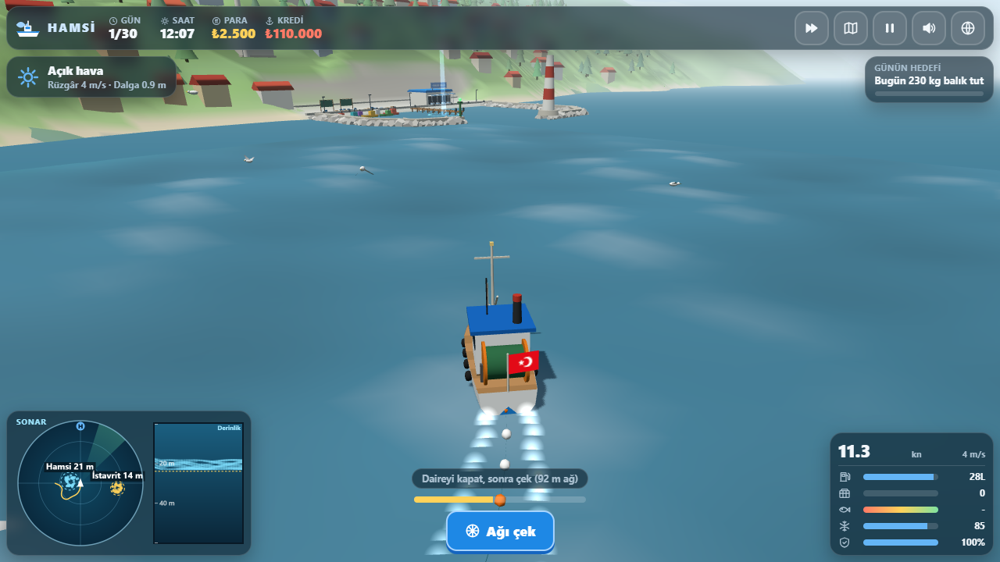
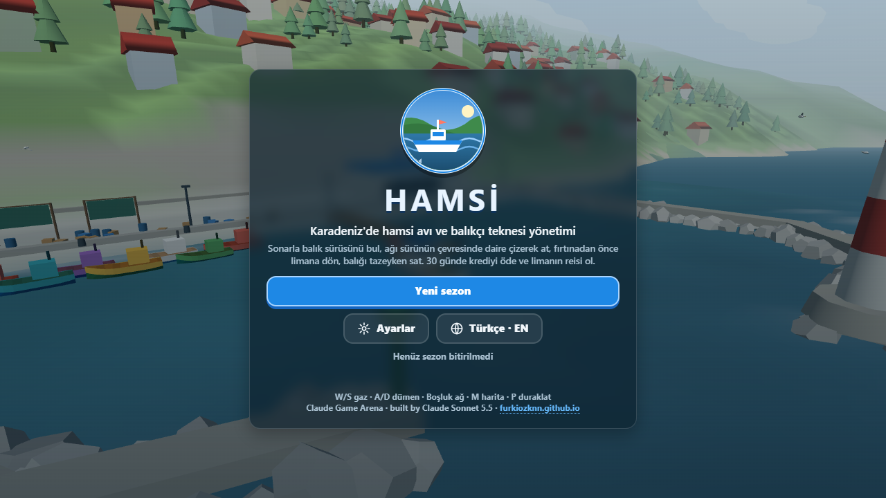
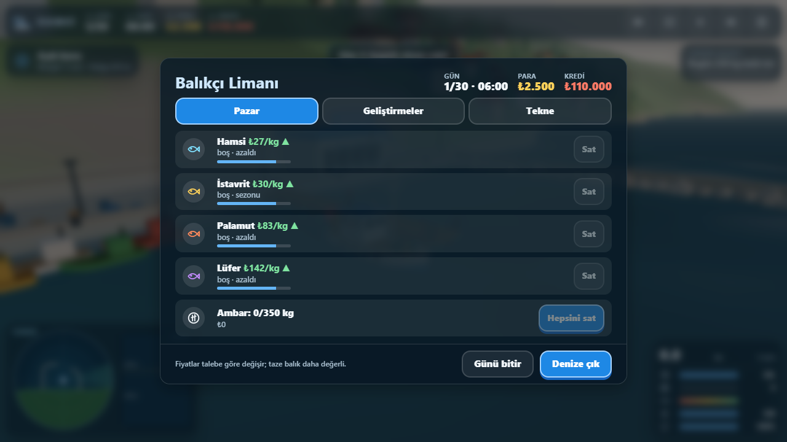
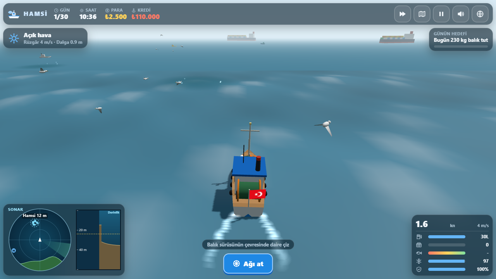
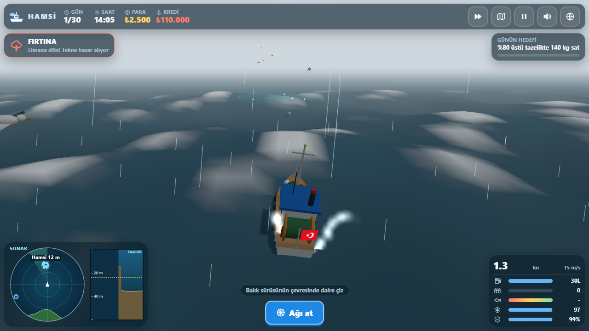
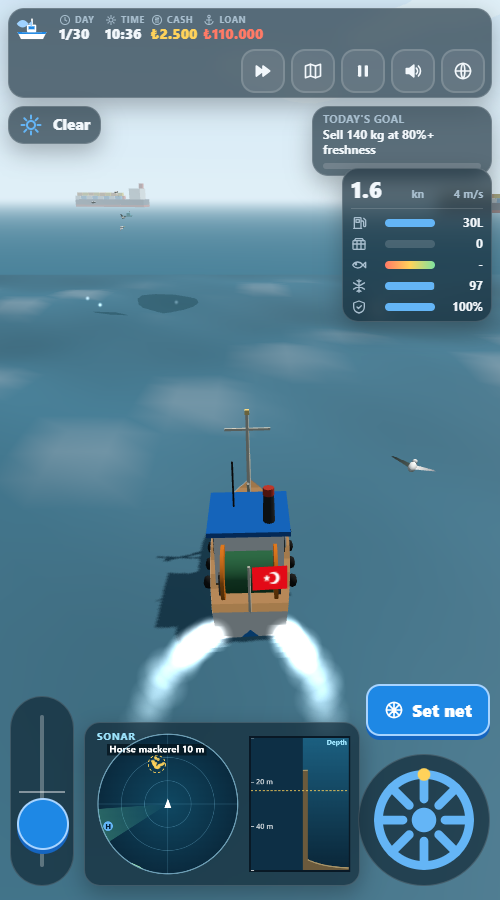

# Hamsi

A 3D fishing and boat-management game on the Black Sea coast. Sail a traditional blue-and-white wooden fishing boat out of a
small harbour, find schools of fish on the sonar, circle a purse-seine net around a school, race home before the storm and
sell the catch fresh at the fish market. Pay off the boat loan in a 30-day season and become *reis* of the harbour.

Built by Claude Sonnet 5.5 with Claude Code from one prompt: [prompts/hamsi.md](prompts/hamsi.md).
Part of the Claude Game Arena series.

## How to play

1. **Sail out.** Open the harbour screen, buy fuel and ice if needed, press *Sail out*. Throttle and rudder behave like a
   boat: the engine builds speed slowly, the rudder only bites when you are moving, waves pitch and roll the hull and the
   wind pushes you sideways.
2. **Find a school.** The sonar panel shows the schools around you as moving dots (they are real boids under the water),
   with species, depth and, after the sonar upgrade, an estimated weight. The fish finder strip on the right shows what is
   below the keel and the dashed yellow line is how deep your net reaches. Gulls circle over rich schools and shallow
   schools show as a dark patch with splashing fish.
3. **Set the net.** Press `Space` close to a school and drive a circle around it while the net pays out behind the boat.
   Hamsi (anchovy) and istavrit (horse mackerel) are slow and calm; palamut (bonito) and lüfer (bluefish) are fast, nervous
   and worth much more. Fish that are deeper than the net escape under it.
4. **Haul.** Press `Space` again. The ring closes and the crew pulls the net in. A tight circle catches most of the school;
   a gap lets the fish inside slip out near the opening.
5. **Beat the weather.** Mornings can be misty. Some days a storm is forecast: you get a warning a few hours ahead, then
   wind, rain and big waves that damage the hull while you are outside the harbour. At 18:00 the coast guard tows you home
   for a fee.
6. **Dock and sell.** Slow down inside the blue ring at the pier and press `Space` (or the Dock button). Sell at the fish
   market (prices follow the season and fall as you sell; fresh fish pays more), refuel, add ice, repair, pay the loan and
   buy upgrades: bigger net, better sonar, engine, hold, ice box and crew.
7. **Win.** After 30 days the loan must be paid. Each day also has a goal with a cash bonus.

## Controls

| Action | Keyboard | Touch |
|---|---|---|
| Throttle | `W` / `S` (lever stays where you leave it) | throttle slider |
| Rudder | `A` / `D` or arrow keys | rudder wheel |
| Set net / haul net / dock | `Space` | Net / Dock buttons |
| Map | `M` | map button |
| Pause / back | `P` or `Esc` | pause button |
| Music on/off | `N` | sound button (mutes all) |
| Effects on/off | `X` | |
| Language TR / EN | `L` | globe button |
| Time speed x1 / x2 / x3 | `T` | speed button |
| Camera | drag to orbit, wheel to zoom | drag |

`M` opens the map (as in the game prompt) so music uses `N` here instead of `M`.

## URL flags

| Flag | Effect |
|---|---|
| `?auto` | a bot plays the whole 30-day season with the same controls and rules as a player (sonar data only) |
| `?debug` | shows fps, draw calls, triangles, state and any JavaScript errors; enables `window.hamsiSim(seconds)` |
| `?sim=N` | fast-forwards N seconds before the first frame (starts a new run if needed) |
| `?low` | no shadows, half the particles, no blur on panels |
| `?lang=en` / `?lang=tr` | force the language |
| `?noassets` | skip optional assets (this game has none: everything is generated in code) |

The live state is on `window.hamsi` (day, money, loan, boat, schools, net, weather, `log` of the bot's days,
`assets`, `fps`, `calls`).

## Built with

One `index.html`, Three.js r170 from a CDN (import map), no build step. The ocean is a vertex-displaced grid
(four summed waves, whitecaps on crests, analytic normals) that follows the camera, the coast is a heightfield with tea
terraces, instanced houses and trees, a harbour with moles, pier, fish market and lighthouse, the boat is lofted in code,
fish are boids, and the sound (engine chug, waves, wind, gulls, creaks, market chatter and a kemençe-style horon tune in 7/8)
is synthesised with Web Audio. Settings are saved in `localStorage` under `arena.hamsi.settings`, the run under
`arena.hamsi.save` and the best result under `arena.hamsi.best`.

Measured on the development laptop's Intel UHD iGPU in headless Chrome at 1280x720: 60 fps with 21 to 35 draw calls and about 165k triangles (one directional light with a 1024 shadow map, pixel ratio capped at 1.5, no post-processing).

Turkish is the default language, English is one key (`L`) away.

## Screenshots

| | |
|---|---|
|  |  |
|  |  |

## Licence

MIT, see [LICENSE](LICENSE). No third-party assets are used.
