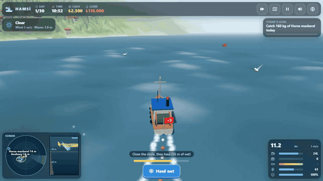

<p align="center">
  <a href="https://furkiozknn.github.io/hamsi/"></a>
</p>

<p align="center">
  <a href="https://furkiozknn.github.io/hamsi/"></a>
  
  
  <a href="LICENSE"></a>
  
</p>

<p align="center"><b>A 3D fishing and boat-management game on the Black Sea coast: find the schools on the sonar, circle a purse-seine net around them, race home before the storm, sell the catch fresh and pay off the boat loan in a 30-day season to become reis of the harbour.</b></p>

<p align="center">
  
</p>

<p align="center"><b>Play online: <a href="https://furkiozknn.github.io/hamsi/">https://furkiozknn.github.io/hamsi/</a></b> (desktop and phone, no install)</p>

## Highlights

- **A boat that handles like a boat.** The engine builds speed slowly, the rudder only bites when you are moving,
  waves pitch and roll the hull and the wind pushes you sideways.
- **Sonar and real schools.** The schools are boids under the water. The sonar shows them as moving dots with species
  and depth, the fish finder strip shows what is under the keel and how deep your net reaches; gulls circle over rich
  schools and shallow ones splash at the surface.
- **Purse-seine fishing.** Drive a circle around a school while the net pays out, then haul. A tight circle catches
  most of the school; a gap lets fish slip out, and fish deeper than the net escape under it. Hamsi and istavrit are
  slow and calm, palamut and lüfer fast, nervous and worth much more.
- **Weather and a market.** Misty mornings, forecast storms that damage the hull outside the harbour, a coast guard
  tow at 18:00. Prices follow the season and fall as you sell; fresh fish pays more. Buy fuel, ice, repairs and
  upgrades for the net, sonar, engine, hold, ice box and crew.
- **Played by a bot.** `?auto` plays the whole 30-day season with the same controls and rules as a player, using only
  sonar data. Measured: **season finished as reis, loan paid on day 26-27**, 60 fps, 21-35 draw calls.
- **One file, made in code.** One `index.html` with Three.js r170 from a CDN: a wave-displaced ocean, a coast with tea
  terraces and a harbour, a boat lofted in code, and engine, waves, gulls and a kemençe-style horon tune in 7/8
  synthesised with Web Audio.

## How to play

> [!TIP]
> Set the net (`Space`) just ahead of a school and steer a tight circle around it, so the ring closes near where you
> started. Then haul (`Space` again) and head home if the forecast says storm.

1. **Sail out.** Buy fuel and ice in the harbour if needed, then press *Sail out*.
2. **Find a school** on the sonar; the dashed yellow line on the fish finder is how deep your net reaches.
3. **Set the net** near the school, drive a circle around it, then **haul**.
4. **Dock and sell.** Slow down inside the blue ring at the pier and press `Space`. Sell, refuel, add ice, repair,
   pay the loan and buy upgrades.
5. **Win.** After 30 days the loan must be paid. Each day also has a goal with a cash bonus.

### Controls

| Action | Keyboard | Touch |
|---|---|---|
| Throttle | `W` / `S` (the lever stays where you leave it) | throttle slider |
| Rudder | `A` / `D` or arrow keys | rudder wheel |
| Set net / haul net / dock | `Space` | Net / Dock buttons |
| Map | `M` | map button |
| Pause / back | `P` or `Esc` | pause button |
| Music on/off | `N` | sound button (mutes all) |
| Effects on/off | `X` | |
| Language TR / EN | `L` | globe button |
| Time speed x1 / x2 / x3 | `T` | speed button |
| Camera | drag to orbit, wheel to zoom | drag |

`M` opens the map, so music uses `N`. Settings are saved in `localStorage` under `arena.hamsi.settings`, the run under
`arena.hamsi.save` and the best result under `arena.hamsi.best`. Turkish is the default language.

<details>
<summary><b>URL flags for testing</b></summary>

| Flag | Effect |
|---|---|
| `?auto` | a bot plays the whole 30-day season with the same controls and rules as a player (sonar data only) |
| `?debug` | fps, draw calls, triangles, state and any JavaScript errors on screen |
| `?sim=N` | fast-forward N seconds before the first frame (starts a new run if needed) |
| `?low` | no shadows, half the particles, no blur on panels |
| `?lang=en` / `?lang=tr` | language |
| `?noassets` | accepted; the game has no asset files, so nothing changes |

The live state is on `window.hamsi` (day, money, loan, boat, schools, net, weather, the bot's `log` of days, `assets`,
`fps`, `calls`); `window.hamsiSim(seconds)` fast-forwards.

</details>

## Screenshots

<table>
  <tr>
    <td width="33%"><br><sub>Title screen</sub></td>
    <td width="33%"><br><sub>Setting the net</sub></td>
    <td width="33%"><br><sub>Fish market in the harbour</sub></td>
  </tr>
  <tr>
    <td><br><sub>Sailing out</sub></td>
    <td><br><sub>Caught in a storm</sub></td>
    <td><br><sub>On a phone</sub></td>
  </tr>
</table>

## Running locally

Serve the folder over HTTP, for example:

```
python -m http.server 8000
```

then open <http://localhost:8000/>.

## How it was made

Built by **Claude Sonnet 5.5** with Claude Code from one prompt: [prompts/hamsi.md](prompts/hamsi.md).
Everything is generated in code, so there are no asset files and no credits to list.

<details>
<summary><b>Technical notes</b></summary>

- **Ocean:** a vertex-displaced grid of four summed waves with whitecaps on the crests and analytic normals that
  follows the camera.
- **World:** the coast is a heightfield with tea terraces, instanced houses and trees, and a harbour with moles, a
  pier, the fish market and a lighthouse; the boat is lofted in code and the fish are boids.
- **Audio:** engine chug, waves, wind, gulls, creaks, market chatter and a kemençe-style horon tune in 7/8, all
  synthesised with Web Audio.
- **Performance:** measured on the development laptop's Intel UHD iGPU in headless Chrome at 1280x720: 60 fps with
  21-35 draw calls and about 165k triangles (one directional light with a 1024 shadow map, pixel ratio capped at 1.5,
  no post-processing).

</details>

Hamsi is part of the **Claude Game Arena** series, where each game is built by a Claude model from one prompt. The
other games: [Hisar](https://furkiozknn.github.io/kale-savunmasi/) ·
[Çay Ocağı](https://furkiozknn.github.io/cay-ocagi/) · [Çini Ustası](https://furkiozknn.github.io/cini-ustasi/) ·
[Martı](https://furkiozknn.github.io/marti/) · [Kervan](https://furkiozknn.github.io/kervan/) ·
[Dolmuş](https://furkiozknn.github.io/dolmus/) · [Peri Golf](https://furkiozknn.github.io/peri-golf/) ·
[Mehter](https://furkiozknn.github.io/mehter/) · [Boğaz Vapuru](https://furkiozknn.github.io/bogaz-vapuru/) ·
[Simit Fırını](https://furkiozknn.github.io/simit-firini/) · [Karagöz](https://furkiozknn.github.io/karagoz/) ·
[Lale Bahçesi](https://furkiozknn.github.io/lale-bahcesi/)

**Round 5:** [Kapadokya Balonu](https://furkiozknn.github.io/kapadokya-balonu/) ·
[Ebru](https://furkiozknn.github.io/ebru/) · [Kırkpınar](https://furkiozknn.github.io/kirkpinar/) ·
[Çarşı Kaçışı](https://furkiozknn.github.io/carsi-kacisi/)

**Round 6:** [Topkapı Gecesi](https://furkiozknn.github.io/topkapi-gecesi/) · **Hamsi** ·
[Pamukkale](https://furkiozknn.github.io/pamukkale/) · [Mimar Sinan](https://furkiozknn.github.io/mimar-sinan/)

## Türkçe

**Hamsi**, Karadeniz kıyısında geçen 3D balıkçılık ve tekne yönetimi oyunu. Mavi beyaz ahşap teknenle limandan çık,
sonarla balık sürüsünü bul, ağı sürünün çevresinde daire çizerek at, fırtınadan önce limana dön ve balığı tazeyken
balık halinde sat. 30 günlük sezonda tekne kredisini öde, limanın reisi ol. Kurulum yok; masaüstünde ve telefonda
tarayıcıda oynanır. Claude Sonnet 5.5 tarafından Claude Code ile tek bir prompt'tan yapıldı.

**Oyna:** https://furkiozknn.github.io/hamsi/

## License

MIT, see [LICENSE](LICENSE).
