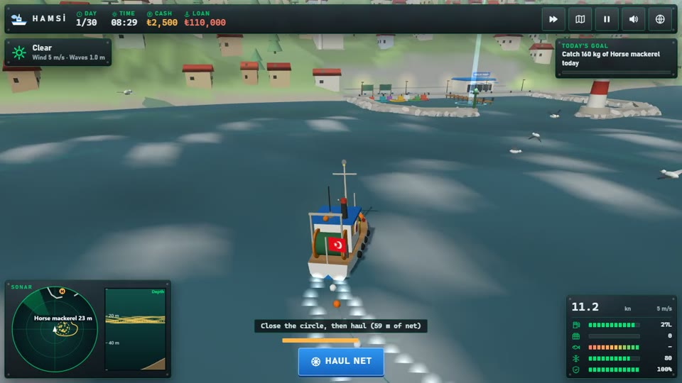

<p align="center">
  <a href="https://furkiozknn.github.io/hamsi/">
    
  </a>
</p>

<p align="center">
  <a href="https://furkiozknn.github.io/hamsi/"></a>
</p>

<p align="center">
  
  
  <a href="LICENSE"></a>
  
</p>

<!-- portals:start -->
<p align="center">
  Also on: <a href="https://furkiozknn.itch.io/hamsi"><strong>itch.io</strong></a> &middot; <a href="https://playgama.ai/play/ucyjxjsqamcub6"><strong>Playgama</strong></a>
</p>
<!-- portals:end -->

<p align="center">
  <strong>A 3D fishing and boat-management game on the Black Sea coast: find the schools on the sonar, circle a purse-seine net around them, race home before the storm, sell the catch fresh and pay off the boat loan in a 30-day season to become reis of the harbour.</strong>
</p>

<!-- gameplay gif -->

## Features

- **Purse-seine fishing & sonar:** Track underwater boid schools on the sonar with depth and species readouts; circle a school to deploy the net and haul before fish escape, pursuing calm hamsi and istavrit or fast, nervous and valuable palamut and lüfer.
- **Dynamic weather & harbour economy:** Face misty mornings, forecast storms that damage the hull, and an 18:00 coast guard tow across a 30-day season; sell fresh catch as seasonal market prices fall, refuel, buy ice, and upgrade the net, sonar, engine, hold, ice box, and crew to pay off the loan and become harbour reis.
- **Realistic boat handling & maritime world:** Inertial throttle, rudder bite that depends on forward speed, wave pitch and roll, tea-terraced coastline with harbour moles and lighthouse, circling gulls, and an authentic kemençe-style horon tune in 7/8 synthesized with Web Audio.
- **Ultra-lean web performance:** A single `index.html` running Three.js r170 delivering 60 fps at 18–56 draw calls on Intel UHD 620 (tested at 500x900 on phone layout), verified by an automated `?auto` bot completing the full 30-day season with 0 JavaScript errors.

## How to play

> [!TIP]
> **Goal:** Pay off the boat loan in a 30-day season and become reis of the harbour. Set the net (`Space`) just ahead of a school and steer a tight circle around it so the ring closes near where you started, then haul (`Space` again) and head home before the storm.

1. **Sail out:** Buy fuel and ice in the harbour if needed, then click *Sail out*.
2. **Find a school:** Track moving dots and depth on the sonar; the dashed yellow line on the fish finder shows how deep your net reaches.
3. **Set and haul:** Press `Space` near the school, steer a full circle around it to close the cork ring, then press `Space` to haul.
4. **Dock and sell:** Slow down inside the blue ring at the pier and press `Space`. Sell catch fresh, refuel, add ice, repair hull damage, pay loan installments, and purchase upgrades.
5. **Win:** Complete daily goals for cash bonuses and pay off the loan in full within 30 days to become reis of the harbour.

<details>
<summary><b>Fishing mechanics and economy</b></summary>

- **School behavior:** Hamsi and istavrit are calm and slow; palamut and lüfer are fast, nervous, and significantly more valuable.
- **Purse-seine net:** A tight circle catches most of the school; gaps allow fish to slip out, and fish swimming deeper than the net line escape underneath.
- **Weather hazards:** Morning mist obscures vision, while forecast storms cause progressive hull damage outside the safety of the harbour.
- **Coast guard tow:** If stranded or out past 18:00, the coast guard will tow your boat back to port.
- **Market prices:** Fish prices follow seasonal supply and drop as you sell larger volumes; fresher fish fetches premium market rates.
- **Upgrades:** Invest harbour earnings into net size, sonar range, engine power, hold capacity, ice box insulation, and hiring crew.

</details>

### Controls

| Action | Keyboard | Touch |
|---|---|---|
| Throttle | `W` / `S` (the lever stays where you leave it) | Throttle slider |
| Rudder | `A` / `D` or arrow keys | Rudder wheel |
| Set net / haul net / dock | `Space` | Net / Dock buttons |
| Map | `M` | Map button |
| Pause / back | `P` or `Esc` | Pause button |
| Music on/off | `N` | Sound button (mutes all) |
| Effects on/off | `X` | |
| Language TR / EN | `L` | Globe button |
| Time speed x1 / x2 / x3 | `T` | Speed button |
| Camera | Drag to orbit, wheel to zoom | Drag to orbit |

- **Audio control:** `N` toggles music (`M` opens the map), `X` toggles sound effects; the speaker button in the top bar mutes music and effects together and is remembered.
- **Touch:** Virtual throttle slider, rudder wheel, map, sound, language globe, speed toggle, and context Net / Dock buttons.
- **Time & camera:** `T` cycles simulation speed (x1 / x2 / x3); drag to orbit the camera, mouse wheel to zoom.
- **Persistence:** Settings are saved in `localStorage` under `arena.hamsi.settings`, active run under `arena.hamsi.save`, and best result under `arena.hamsi.best`. Turkish is the default language.

<details>
<summary><b>URL flags for testing</b></summary>

| Flag | Effect |
|---|---|
| `?auto` | A bot plays the whole 30-day season with the same controls and rules as a player (sonar data only) |
| `?debug` | FPS, draw calls, triangles, state, and any JavaScript errors on screen |
| `?sim=N` | Fast-forward N seconds before the first frame (starts a new run if needed) |
| `?low` | No shadows, half the particles, no blur on panels |
| `?lang=en` / `?lang=tr` | Language |
| `?noassets` | Accepted for the arena convention; the game uses no external assets anyway |

The live state is accessible on `window.hamsi` (`day`, `money`, `loan`, `boat`, `schools`, `net`, `weather`, the bot's `log` of days, `assets`, `fps`, `calls`); `window.hamsiSim(seconds)` fast-forwards.

</details>

## Screenshots

<table>
  <tr>
    <td width="33%"><br><sub>Title screen</sub></td>
    <td width="33%"><br><sub>Setting the net</sub></td>
    <td width="33%"><br><sub>Fish market in the harbour</sub></td>
  </tr>
  <tr>
    <td><br><sub>Leaving the harbour</sub></td>
    <td><br><sub>Caught in a storm</sub></td>
    <td><br><sub>On a phone</sub></td>
  </tr>
</table>

## Redesign & Performance

**Art direction:** Moody maritime stylized. Black Sea slate `#24343F`, foam `#E6F0F2`, boat blue `#1E88E5`, tea-terrace green `#4C7A3A`, sodium harbour `#FFB74D`, with sonar green `#00E676` for the instruments. The HUD is a set of wet-weather instrument panels (dark steel, rivets, sonar-green hairlines, monospace readouts, segmented gauge bars).

**Visual updates (physics, controls, scoring, bot, saves and the 30-day structure are untouched):**
- **Palette and light:** Desaturated slate sea with deeper wave troughs and whitecaps, overcast-leaning sky, warmer low sun, darker forest and wet-concrete quay.
- **Environment:** Two scrolling mist rings plus nine low mist banks along the coast (thicker in morning fog and storms), houses with windows, doors and chimneys, sodium harbour lamps that glow more in mist, storms and evening.
- **Boat and crew:** Trawler with an A-frame, fish boxes, navigation lights, lit wheelhouse windows and a deck lamp that brighten in bad light, sou'wester hats on the crew, floats that bob on the net.
- **Animation and FX:** Denser, longer rain streaks, rain droplets on the lens during storms, sonar ping ring leaving the hull every 3.2 s.
- **UI:** Every screen (title, HUD, harbour, summary, ending, pause, settings, map) restyled; sonar, fish finder and map redrawn in sonar green on dark; Bahnschrift / Cascadia Mono system fonts with fallbacks, no new files or requests.
- **Mist & notifications:** Slate-blue capped mist fog density keeps crests and coast readable ([docs/07-mist.png](docs/07-mist.png)); repeated identical toasts no longer stack.
- **Phone:** Verified at 500x900 with the new panels.

**Measured on an Intel UHD 620 (headless Chrome, 1280x720):**
- Draw calls: 18 before &rarr; 23–24 after while sailing clear water, up to 49–56 after during netting, storms and harbour views (budget about 150)
- Page rAF: 60 fps in gameplay (both before and after)
- Phone (500x900): layout verified with responsive panels
- Bot run: `?auto` bot finished the 30-day season as reis with the loan paid, with 0 JavaScript errors (with assets and with `?noassets`)


## Running locally

Serve the folder over HTTP (ES modules do not load from `file://`):

```bash
python -m http.server 8000
```

Then open <http://localhost:8000/>.

## Made with Claude Code

Built by **Claude Sonnet 5.5** with Claude Code from one prompt: [prompts/hamsi.md](prompts/hamsi.md). Everything is generated in code, so there are no asset files and no credits to list; Three.js is loaded from a CDN under its MIT licence.

<details>
<summary><b>Technical notes</b></summary>

- **Ocean:** A vertex-displaced grid of four summed waves with whitecaps on the crests and analytic normals that follows the camera.
- **World:** The coast is a heightfield with tea terraces, instanced houses and trees, and a harbour with moles, a pier, the fish market and a lighthouse; the boat is lofted in code and the fish are boids.
- **Audio:** Engine chug, waves, wind, gulls, creaks, market chatter and a kemençe-style horon tune in 7/8, all synthesised with Web Audio.
- **Performance:** Measured on the development laptop's Intel UHD 620 iGPU in headless Chrome at 1280x720: 60 fps with 18–56 draw calls (one directional light with a 1024 shadow map, pixel ratio capped at 1.5, no post-processing).

</details>

### Claude Game Arena

Hamsi is part of the **Claude Game Arena** series, where each game is built by a Claude model from one prompt.

[Hisar](https://furkiozknn.github.io/kale-savunmasi/) · [Çay Ocağı](https://furkiozknn.github.io/cay-ocagi/) · [Çini Ustası](https://furkiozknn.github.io/cini-ustasi/) · [Martı](https://furkiozknn.github.io/marti/) · [Kervan](https://furkiozknn.github.io/kervan/) · [Dolmuş](https://furkiozknn.github.io/dolmus/) · [Peri Golf](https://furkiozknn.github.io/peri-golf/) · [Mehter](https://furkiozknn.github.io/mehter/) · [Boğaz Vapuru](https://furkiozknn.github.io/bogaz-vapuru/) · [Simit Fırını](https://furkiozknn.github.io/simit-firini/) · [Karagöz](https://furkiozknn.github.io/karagoz/) · [Lale Bahçesi](https://furkiozknn.github.io/lale-bahcesi/)

**Round 5:** [Kapadokya Balonu](https://furkiozknn.github.io/kapadokya-balonu/) · [Ebru](https://furkiozknn.github.io/ebru/) · [Kırkpınar](https://furkiozknn.github.io/kirkpinar/) · [Çarşı Kaçışı](https://furkiozknn.github.io/carsi-kacisi/)

**Round 6:** [Topkapı Gecesi](https://furkiozknn.github.io/topkapi-gecesi/) · **Hamsi** · [Pamukkale](https://furkiozknn.github.io/pamukkale/) · [Mimar Sinan](https://furkiozknn.github.io/mimar-sinan/)

## License

MIT, see [LICENSE](LICENSE).

Like the game? You can support new rounds on [Buy Me a Coffee](https://buymeacoffee.com/furkiozkann). The game stays free.
